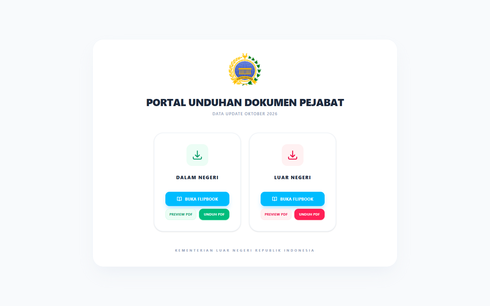
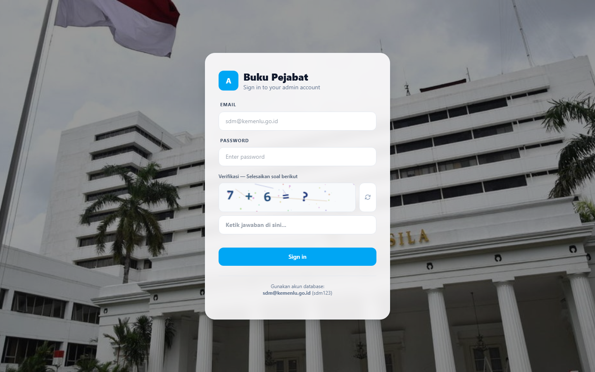
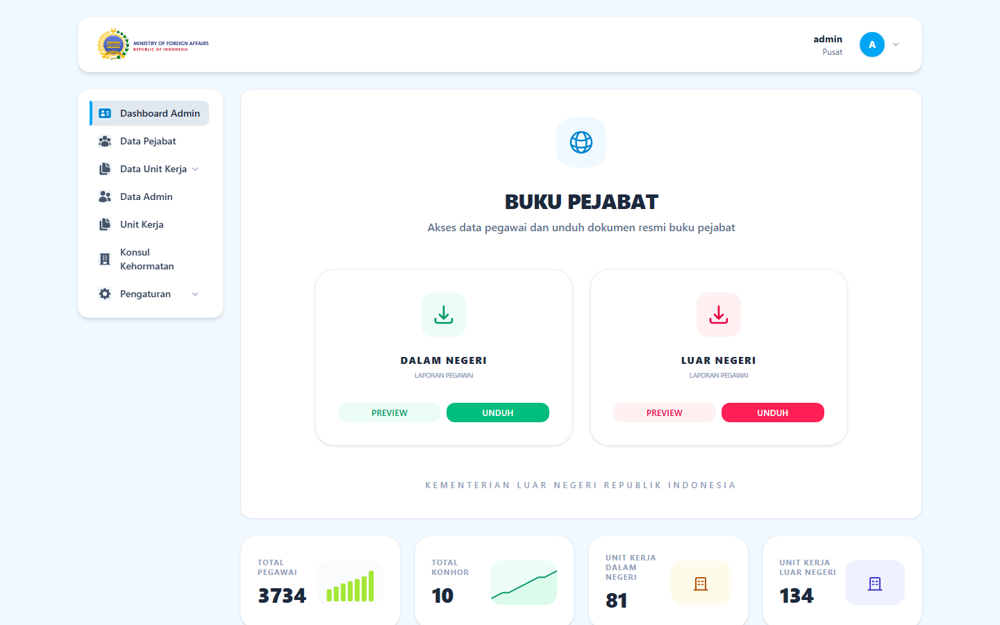
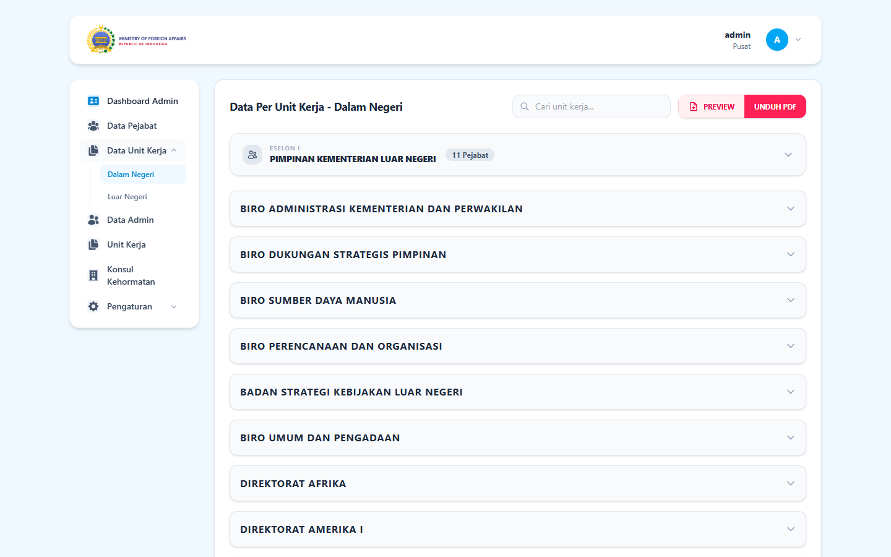

<div align="center">

# 📒 Buku Pejabat

**Sistem Manajemen & Publikasi Direktori Pejabat**

A full-stack web application for managing employee directories and publishing official document books — featuring a public document portal with client-side PDF generation and an interactive flipbook reader, backed by a role-based admin panel.


</div>

---

## ✨ Features

### 🌐 Public Portal (No login required)
- **PDF Preview & Download** — official document books generated entirely in the browser with jsPDF (no server-side PDF rendering)
- **Flipbook Reader** — interactive page-flip document experience powered by `react-pageflip`
- **Download activity tracking** — anonymous hit counters for analytics

### 🔐 Admin Panel (Role-based, Sanctum auth)
- **Dashboard** — employee & representation unit statistics with charts
- **Employee Directory** — full CRUD, search, and filter across 3,700+ records
- **Work Units** — manage domestic (Dalam Negeri) and overseas (Luar Negeri) units
- **Honorary Consuls** — manage consular data and personnel assignments
- **User Management** — accounts with role hierarchy (`superadmin` / `admin`)
- **Data Synchronization** — pull employee data from an external API, manual trigger or scheduled (weekly/monthly) auto-sync with full logging
- **Activity & Sync Logs** — audit trail with CSV export
- **Login Security** — math CAPTCHA challenge on the sign-in form

---

## 📸 Screenshots

| Public Portal | Login |
|:-:|:-:|
|  |  |

| Admin Dashboard | Directory View |
|:-:|:-:|
|  |  |

---

## 🛠 Tech Stack

| Layer | Technology |
|-------|-----------|
| Backend | Laravel 12 · PHP 8.2+ · Laravel Sanctum |
| Frontend | React 19 · React Router 6 · Vite 7 |
| Styling | Tailwind CSS 4 |
| Testing | Pest 4 · PHPUnit 12 |
| Charts | Recharts |
| PDF / Documents | jsPDF · jspdf-autotable · react-pageflip · SheetJS (xlsx) |
| Database | MySQL 8 |

---

## 🎨 Design System

Custom UI primitives built on Tailwind CSS — consistent, accessible, and lightweight:

| Primitive | Description |
|-----------|-------------|
| `Button` | Variants: `primary`, `success`, `danger`, `softSuccess`, `softDanger`, `ghost` |
| `Input` / `Textarea` / `Select` | Form fields with label, error state, and consistent styling |
| `Dropdown` | Custom select with animation, check icon, and smart open direction |
| `SearchableSelect` | Combobox with search filter for long lists |
| `Pagination` | Page navigation with configurable items-per-page |
| `Card` / `ConfirmModal` | Layout and confirmation dialog components |

---

## 🚀 Getting Started

### Requirements
- PHP >= 8.2 with Composer
- Node.js >= 18 with npm
- MySQL 8

### Installation

```bash
# 1. Clone the repository
git clone <your-repo-url>.git
cd bukupejabat-portfolio

# 2. Install backend & frontend dependencies
composer install
npm install

# 3. Configure environment
cp .env.example .env
php artisan key:generate
# Edit .env → set DB_DATABASE=buku_pejabat_portfolio (or your DB name)

# 4. Create the database, then migrate
mysql -u root -p -e "CREATE DATABASE buku_pejabat_portfolio CHARACTER SET utf8mb4 COLLATE utf8mb4_unicode_ci;"
php artisan migrate

# 5. Build the frontend
npm run build

# 6. Run
php artisan serve
```

The app will be available at `http://localhost:8000`.

### 👤 Demo Account

| Username | Password | Role |
|----------|----------|------|
| `admin` | `password` | superadmin |

---

## 📂 Project Structure

```
├── app/Http/Controllers/Api/   # REST API controllers (35 endpoints)
├── app/Models/                 # Eloquent models (Pegawai, UnitKerja, Jabatan, ...)
├── database/migrations/        # Schema migrations
├── resources/js/src/
│   ├── pages/                  # PagePublic, Dashboard, Directory, Login, ...
│   ├── components/
│   │   ├── ui/                 # Design system primitives (Button, Input, Dropdown, ...)
│   │   └── ...                 # FlipbookViewer, charts, etc.
│   └── data/                   # Sample anonymized dataset (JSON)
├── tests/
│   └── Feature/                # 69 Pest feature tests
└── routes/api.php              # Public + Sanctum-protected routes
```

---

## 🔒 Data Privacy

This repository ships with a **fully anonymized dataset** (3,733 employee records): names, NIP/ID numbers, phone numbers, and birth data have been synthetically replaced. Organizational structure (work units, position titles) is preserved for realism. No personal data of real individuals is included.

---

## 🧪 Testing

69 feature tests covering the full API surface, built with Pest 4:

```bash
php artisan test
```

| Test Suite | Coverage |
|-----------|----------|
| Auth | Login, logout, CAPTCHA, session handling |
| Pegawai | CRUD, search, filter dalam/luar negeri |
| Unit Kerja | CRUD, filtering, public endpoints |
| User Management | Role hierarchy, account CRUD |
| Sync Data | Config CRUD, external API sync (mocked) |
| Activity / Sync Logs | Audit trail, CSV export |
| Public Activity | Download & flipbook hit tracking |

---

## 📌 Notes

- The external data-sync feature (Settings → Sync Data) expects an internal API endpoint and is disabled by default.
- PDF generation runs 100% client-side — the server never renders PDFs.
- This is a portfolio edition of an internal project; infrastructure-specific integrations have been removed.
- Performance optimizations: route-level code splitting, lazy-loaded heavy libraries (jsPDF, xlsx, SweetAlert2, react-pageflip), compressed image assets.

---

<div align="center">

Made with ❤️ by Ahnaf

</div>
